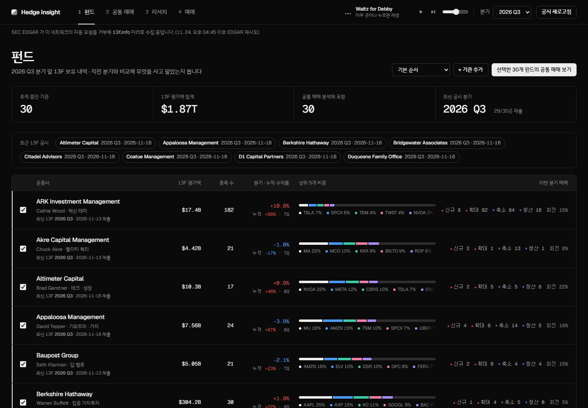
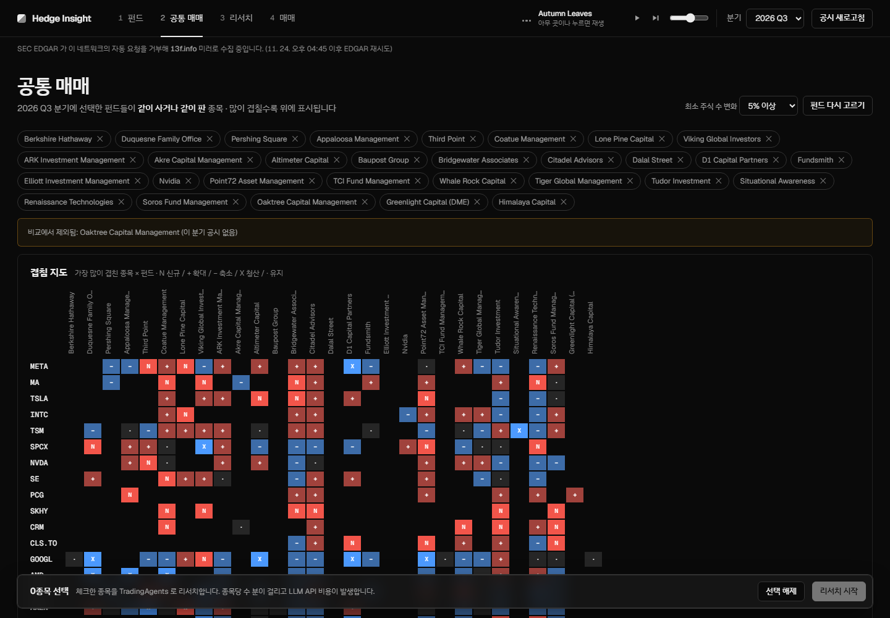
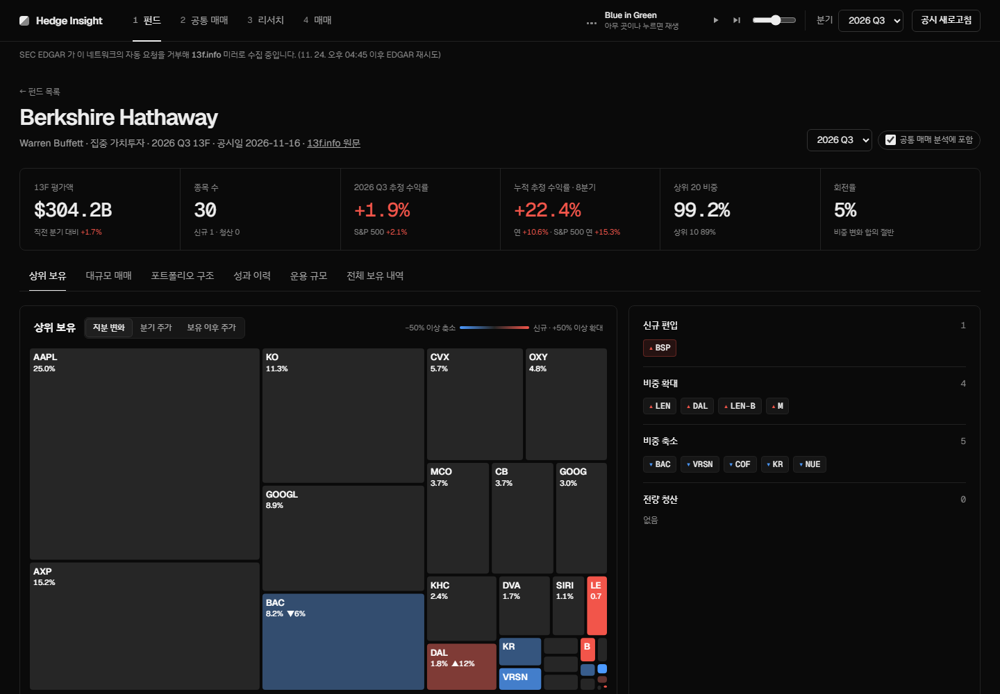
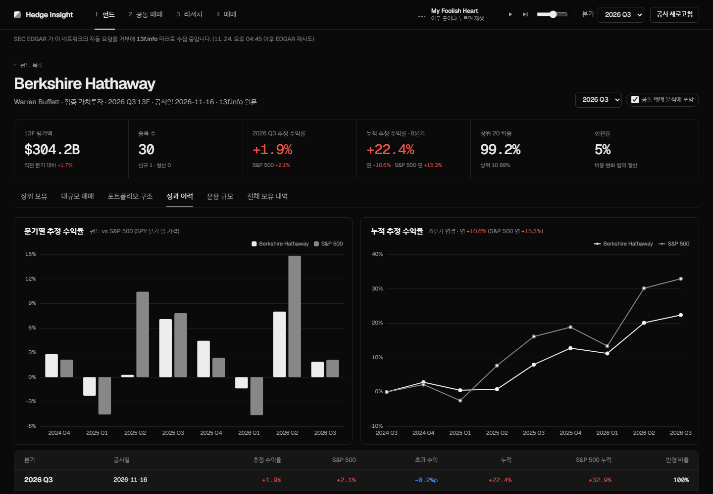
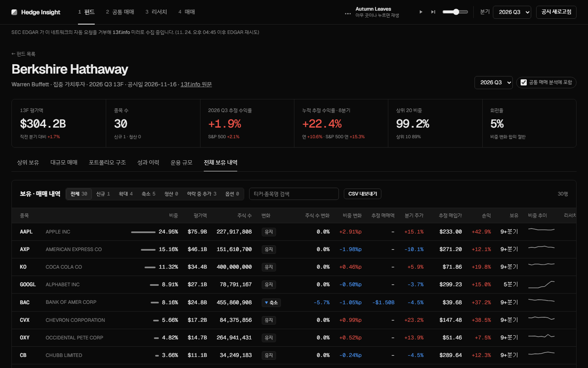
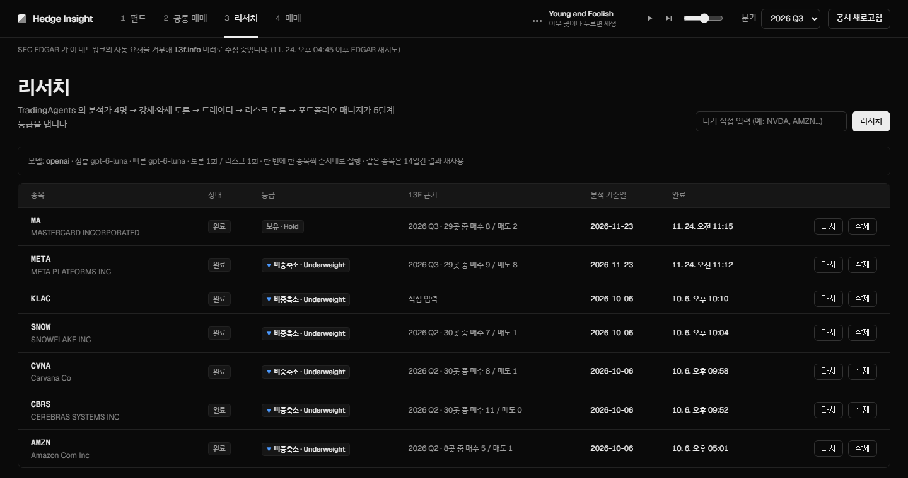
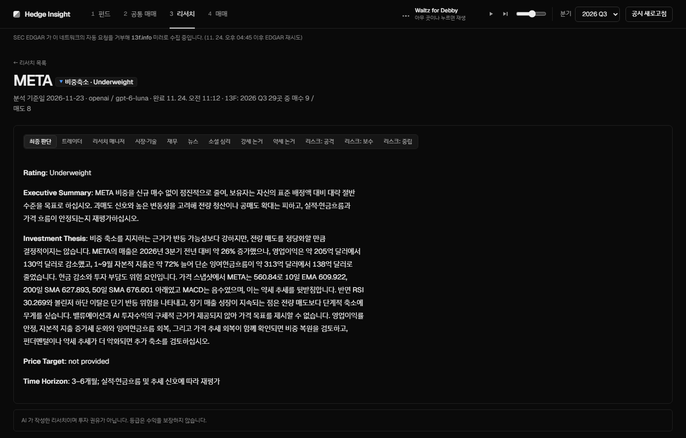
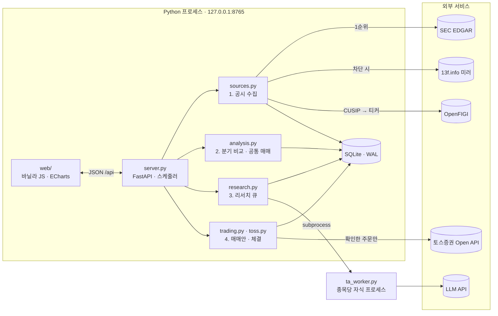

# Hedge Insight (Claude edition)

유명 헤지펀드의 13F 공시 → 여러 펀드가 같이 사고 판 종목 → TradingAgents 리서치 → 등급에 따른 매매.
한 개의 Python 프로세스로 도는 로컬 웹앱입니다.

```
1 펀드        펀드별 최신 공시 분기 · 상위 보유 · 대규모 매매 · 포트폴리오 구조 · 성과 이력 · 운용 규모
2 공통 매매    내가 고른 펀드들이 같이 사고 판 종목 (겹침 순)
3 리서치      TradingAgents 멀티 에이전트 분석 → Buy / Overweight / Hold / Underweight / Sell
4 매매        등급 → 매매안 → 확인 후 모의 체결 또는 토스 실주문
```

## 실행 화면

흑백 다크 대시보드입니다. 색은 상승(빨강)·하락(파랑)과 차트 계열에만 쓰고, 숫자는 고정폭 글꼴로 자릿수를 맞춥니다.

**펀드 목록**: 추적 중인 기관마다 최신 13F 분기, 평가액, 분기·누적 추정 수익률, 상위 5개 종목 비중, 이번 분기 매매 건수를 보여 줍니다.



**공통 매매**: 고른 펀드들이 같은 분기에 함께 사고판 종목을 겹친 수 순서로 보여 줍니다. 칸마다 `N` 신규 · `+` 확대 · `−` 축소 · `X` 청산 · `·` 유지입니다. 직전 분기 공시가 없는 펀드는 비교에서 빼고 이유를 표시합니다.



**펀드 상세**: 상단 지표 줄과 여섯 개 탭으로 구성됩니다. 상위 보유 탭의 트리맵은 크기가 비중, 색이 직전 분기 대비 주식 수 변화입니다.



성과 이력 탭은 "직전 분기 보유분을 그대로 들고 있었다면"의 추정 수익률을 S&P 500 과 비교합니다.



전체 보유 내역 탭에는 종목별 매매, 분기 주가, 추정 매입가, 손익, 보유 기간이 나옵니다.



**리서치**: 공통 매매에서 고른 종목을 TradingAgents 로 한 종목씩 분석해 5단계 등급을 받습니다. 13F 근거(몇 곳 중 몇 곳이 샀는지)를 함께 저장합니다. 아래는 2026 Q3 공통 매수 상위 두 종목을 TradingAgents v0.7.1 로 실제로 돌린 결과입니다. META(29곳 중 매수 9 · 매도 8)는 **Underweight**, MA(매수 8 · 매도 2)는 **Hold** 가 나왔고 종목당 약 3분 걸렸습니다.



보고서는 최종 판단, 트레이더, 분석가 4명, 강세·약세 토론, 리스크 토론까지 에이전트별 탭으로 볼 수 있습니다.



## 아키텍처

Python 프로세스 하나가 웹 서버, 공시 갱신 스케줄러, 리서치 큐를 함께 돌립니다. 단계 사이에는 SQLite 만 두고, 시간이 오래 걸리는 LLM 분석만 별도 프로세스로 실행합니다.



모듈마다 왜 그렇게 설계했는지, 데이터 모델, 동시성, 보안, 테스트, 해결한 문제는 **[설계 문서](docs/ARCHITECTURE.md)** 에 정리했습니다.

## 실행

```powershell
.venv\Scripts\python.exe -X utf8 -m hedge.server
```

브라우저에서 <http://127.0.0.1:8765> 을 엽니다. 처음 실행하면 펀드 목록의 13F 공시를 자동으로 가져옵니다(1~2분).

처음부터 설치할 때:

```powershell
uv venv --python 3.12 .venv            # 또는 python -m venv .venv (3.12+)
uv pip install --python .venv\Scripts\python.exe -r requirements.txt
Copy-Item .env.example .env            # 값 채우기
```

테스트(네트워크·브로커 없이 동작): `.venv\Scripts\python.exe -X utf8 -m unittest discover -s tests`

## 설정 (.env)

| 키 | 설명 |
| --- | --- |
| `SEC_USER_AGENT` | SEC EDGAR 요청에 쓰는 `이름 이메일` |
| `FILINGS_SOURCE` | `auto`(기본) · `edgar` · `13finfo` |
| `RESEARCH_PROVIDER`, `RESEARCH_DEEP_MODEL`, `RESEARCH_QUICK_MODEL` | TradingAgents 가 쓸 LLM. 제공자에 맞는 `*_API_KEY` 필요 |
| `RESEARCH_DEBATE_ROUNDS`, `RESEARCH_RISK_ROUNDS`, `RESEARCH_LANGUAGE` | 토론 횟수, 보고서 언어 |
| `TOSS_CLIENT_ID`, `TOSS_CLIENT_SECRET`, `TOSS_ACCOUNT_SEQ` | 토스증권 Open API. WTS > 설정 > Open API 에서 이 PC 의 공인 IP 를 허용해야 합니다 |
| `TOSS_ENABLE_LIVE` | `true` 일 때만 실주문 전송 가능. 기본 `false` |

Claude 로 리서치하려면 `RESEARCH_PROVIDER=anthropic`, 모델 ID(예: 심층 `claude-opus-5-5` / 빠른 `claude-haiku-5-5`), `ANTHROPIC_API_KEY` 를 넣으면 됩니다.

## 동작 방식

### 1. 공시 수집 — `hedge/sources.py`

- **SEC EDGAR**(공식)를 먼저 시도하고, SEC 가 자동 요청을 거부(HTTP 403/429)하면 6시간 동안 EDGAR 를 건드리지 않고 **13f.info**(같은 13F 를 티커와 함께 제공하는 무료 미러)로 전환합니다.
- 펀드마다 최근 8개 분기(2년)를 저장합니다. 성과 이력·운용 규모 탭이 이 기간을 씁니다. 한 분기에 정정 공시가 여러 개면 가장 늦게 제출된 "전체 재작성본"을 쓰고, 일부 종목만 추가한 정정은 건너뜁니다.
- CUSIP 마다 티커를 하나로 고정합니다. 분기마다 수집 경로가 달라도 같은 종목이 같은 키로 비교됩니다.
- 서버가 켜져 있으면 12시간마다 새 공시를 확인합니다. 새 분기(예: 11월 중순의 3분기 공시)가 들어오면 분기 선택에 자동으로 나타납니다.
- 분석 결과는 메모리에 캐시하고, 갱신에서 실제로 새로 저장된 공시가 있을 때만 캐시를 비웁니다. 새 공시가 없는 정기 확인 중에도 화면이 느려지지 않습니다.

### 2. 분기 비교와 공통 매매 — `hedge/analysis.py`

13F 는 분기 말 스냅샷이므로 "이번 분기에 샀다/팔았다"는 두 스냅샷의 차이입니다.

- 신규 / 확대 / 축소 / 청산 / 유지 는 **주식 수** 기준입니다(가격 변동의 영향 없음).
- **주식 분할 보정**: 여러 펀드의 주식 수가 같은 배수로 변하고 분할 반영 가격 변동이 정상 범위일 때만 분할로 보고 직전 주식 수를 보정합니다. 분할이 "모두가 2배 매수"로 잡히는 것을 막습니다.
- 공통 매매의 **최소 주식 수 변화**(기본 5%) 미만은 유지로 봅니다.
- PUT/CALL 옵션은 펀드 상세에는 보이지만 매수·매도 집계에서는 제외합니다.
- 직전 분기 공시가 없는 펀드는 비교에서 빼고 화면에 사유를 표시합니다.

펀드 카드의 **추정 분기 수익률**은 "직전 분기 말 보유분을 그대로 들고 있었다면"의 수익률입니다. 펀드의 실제 성과가 아닙니다.

### 펀드 상세 탭

펀드 목록에는 펀드마다 **최신 13F 분기와 제출일**, 상단에는 최근 공시 순서가 나옵니다. 펀드를 열면 지표 줄(평가액 · 종목 수 · 분기/누적 추정 수익률 vs S&P 500 · 상위 20 비중 · 회전율) 아래에 탭이 있습니다.

| 탭 | 내용 |
| --- | --- |
| 상위 보유 | 히트맵(색 기준: 지분 변화 / 분기 주가 / 보유 이후 주가) + 신규·확대·축소·청산 종목 |
| 대규모 매매 | 추정 매매액 순 매수·매도 막대와 표 |
| 포트폴리오 구조 | 비중 구성, 집중도 곡선, 포지션 크기 분포, 연속 보유 기간 분포, 주식 vs 옵션 |
| 성과 이력 | 분기별·누적 추정 수익률과 S&P 500 비교 (4분기 이상이면 연환산) |
| 운용 규모 | 분기별 13F 평가액·종목 수, 평가액 변화 = 가격 효과(추정) + 순매매·기타 |
| 전체 보유 내역 | 종목별 비중·매매·분기 주가·추정 매입가·손익·보유 기간·비중 추이. 검색, `하락 중 추가` 필터, CSV 내보내기. 행을 누르면 분기 말 가격 위에 이 펀드의 매수·매도 시점과 매입가 선이 나옵니다 |

- **가격**은 모든 추적 펀드의 13F 평가액÷주식 수 중앙값으로 역산한 분기 말 가격이며 분할을 보정합니다. 배당은 빠집니다.
- **S&P 500**은 추적 펀드가 보고한 SPY(없으면 IVV·VOO)의 분기 말 가격으로 계산합니다.
- **추정 매입가**는 주식 수가 늘어난 분기마다 그 분기 말 가격에 샀다고 보는 평균 단가입니다(축소는 단가 유지, 전량 청산 후 재매수는 새로 계산). 실제 체결가가 아닙니다.
- 펀드 목록의 수익률 칸 아래 줄은 수집된 분기를 이은 **누적 추정 수익률**입니다. 마우스를 올리면 같은 기간 S&P 500 과 비교합니다.
- **보유 기간**은 수집된 분기 안에서만 셉니다. `+`가 붙으면 수집 시작 분기부터 보유 중이라 실제로는 더 길 수 있습니다.

### 3. 리서치 — `hedge/research.py`, `hedge/ta_worker.py`

[TauricResearch/TradingAgents](https://github.com/TauricResearch/TradingAgents) **v0.7.1** 을 릴리스 커밋에 고정해 설치하고 **그래프를 수정하지 않고** 사용합니다
(시장·소셜·뉴스·재무 분석가 → 강세/약세 토론 → 트레이더 → 리스크 토론 → 포트폴리오 매니저).

- 한 번에 한 종목씩, 종목마다 별도 프로세스로 실행합니다. 진행 단계가 화면에 표시되고 중간에 취소할 수 있습니다.
- 같은 종목의 완료된 결과는 **리서치 유효 일수**(매매 탭 설정, 기본 14일) 동안 재사용합니다. 매매안도 같은 기간 안의 등급만 씁니다("다시"를 누르면 새로 실행).
- 미국 상장 티커만 대상입니다(`BN.TO` 같은 해외 상장 표기는 제외).
- 리서치는 주문을 내지 않습니다. 결과는 등급과 보고서뿐입니다.

### 4. 매매 — `hedge/trading.py`, `hedge/toss.py`

| 등급 | 동작 |
| --- | --- |
| Buy | 종목당 금액(기본 $500)까지 매수 |
| Overweight | 그 금액의 일정 비율(기본 50%)까지 매수 |
| Hold | 아무것도 안 함 |
| Underweight | **보유 중이면** 일부(기본 50%) 매도 |
| Sell | **보유 중이면** 전량 매도 |

- 주문은 1주 단위 지정가·당일 유효입니다. 지정가는 현재가에 여유(기본 0.5%)를 둡니다.
- 매도 대금은 같은 실행의 매수 현금으로 쓰지 않습니다.
- 보유 종목 중 리서치가 없는 종목은 매매 탭에서 바로 리서치 대기열에 넣을 수 있습니다.
- **모의투자**: 초기 $10,000 의 로컬 계좌에서 지정가로 즉시 체결합니다. 토스 주문 API 는 호출하지 않습니다.
- **토스 실계좌**: `TOSS_ENABLE_LIVE=true` 이고, 화면에서 주문을 고른 뒤 확인 문구를 직접 입력해야만 전송됩니다.
  서버는 전송 직전에 매매안을 다시 계산해 그 안에 있는 주문만, 계획 수량 이하로만 보냅니다. 실패 시 자동 재전송하지 않습니다.

## 데이터

모두 `data/hedge.sqlite` 한 파일에 있습니다(공시, 리서치 보고서, 모의 계좌, 주문 기록). TradingAgents 의 캐시·로그는 `data/tradingagents/` 에 쌓입니다.
`data/` 를 지우면 처음 상태로 돌아갑니다.

## 알아둘 한계

- 13F 는 분기 말 후 최대 45일 뒤에 공개됩니다. 실제 매매 시점·분기 중 왕복 매매·공매도는 알 수 없습니다.
- 13f.info 미러에는 일부 분기가 빠져 있을 수 있습니다. 빠진 분기는 "공시 없음"으로 표시되고 비교에서 제외됩니다.
- LLM 등급은 수익을 보장하지 않습니다. 이 도구는 투자 조언이 아니며, 실주문의 책임은 사용자에게 있습니다.
- 시장가·소수점·예약 주문, 자동(무인) 주문, 미체결 주문의 정정·취소는 구현하지 않았습니다.
