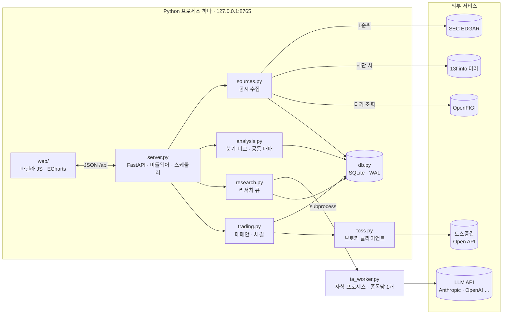
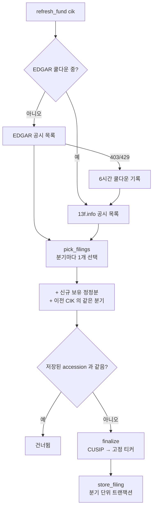
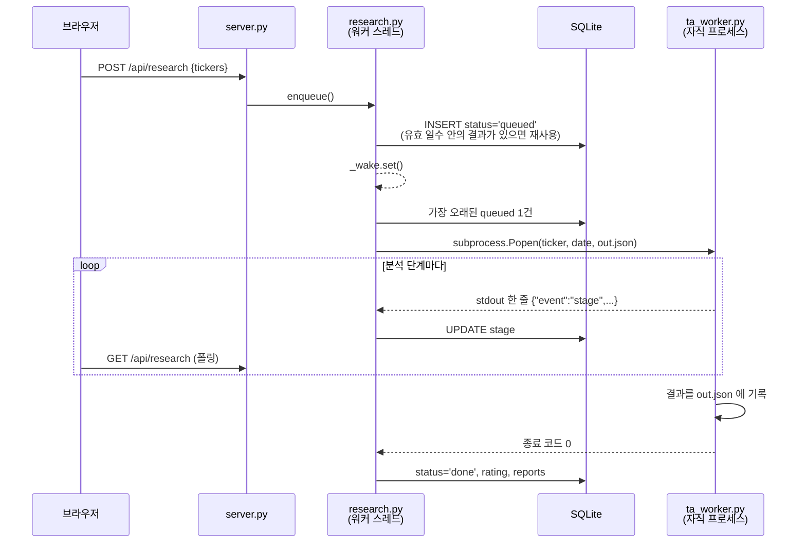
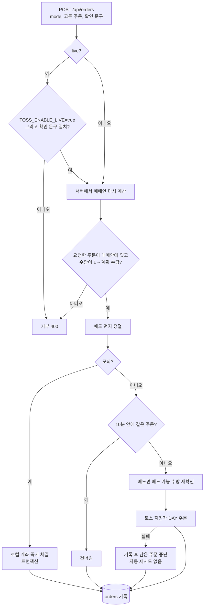
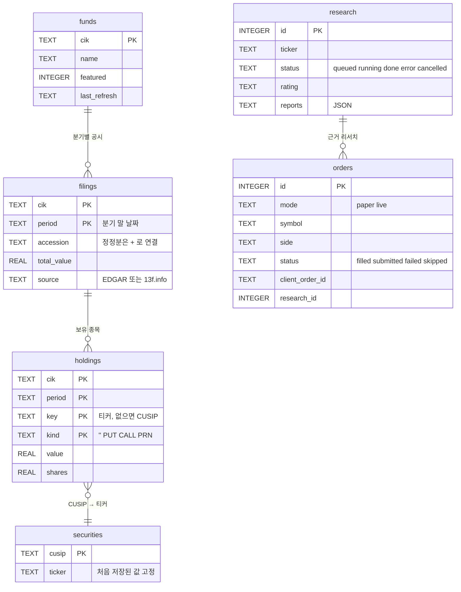

# Hedge Insight 설계 문서

이 문서는 Hedge Insight 가 **어떻게 동작하고, 각 모듈을 왜 그렇게 나눴는지**를 정리합니다.
사용법과 설정은 [README](../README.md) 에 있습니다.

- [1. 한눈에 보기](#1-한눈에-보기)
- [2. 설계 원칙](#2-설계-원칙)
- [3. 모듈별 설계](#3-모듈별-설계)
- [4. 데이터 모델](#4-데이터-모델)
- [5. 동시성 모델](#5-동시성-모델)
- [6. 보안과 안전장치](#6-보안과-안전장치)
- [7. 테스트 전략](#7-테스트-전략)
- [8. 해결한 문제들](#8-해결한-문제들)
- [9. 한계와 확장 방향](#9-한계와-확장-방향)

---

## 1. 한눈에 보기

Hedge Insight 는 **수집 → 비교 → 리서치 → 매매** 네 단계로 이어지는 파이프라인입니다. 단계마다 모듈이 하나씩 있고, 앞 단계의 결과는 SQLite 에 저장된 뒤 다음 단계가 읽습니다.



| 단계 | 모듈 | 입력 | 출력 |
| --- | --- | --- | --- |
| 1. 수집 | `sources.py` | 펀드 CIK | `filings`, `holdings`, `securities` 테이블 |
| 2. 비교 | `analysis.py` | 두 분기의 `holdings` | 펀드별 매매 내역, 공통 매매 순위 (저장하지 않고 계산) |
| 3. 리서치 | `research.py` + `ta_worker.py` | 티커 | `research` 테이블 (5단계 등급 + 보고서) |
| 4. 매매 | `trading.py` + `toss.py` | 최근 등급, 계좌 | 매매안, `orders` 테이블 |

---

## 2. 설계 원칙

모든 모듈 설계는 아래 다섯 가지 원칙을 따릅니다.

1. **혼자 쓰는 로컬 도구로 만든다.** 사용자는 한 명이고 서버는 내 PC 에서만 돕니다. 그래서 별도 DB 서버, 메시지 큐, 인증 서버를 두지 않고 `python -m hedge.server` 한 줄로 실행되게 했습니다.
2. **단계 사이에는 DB 만 둔다.** 각 단계는 앞 단계 모듈을 직접 부르지 않고 DB 에 남은 결과를 읽습니다. 그래서 한 단계가 실패해도 다른 단계는 이미 저장된 데이터로 계속 동작합니다.
3. **추정한 값은 추정이라고 표시한다.** 13F 는 분기 말 스냅샷뿐이라 수익률과 매입가는 계산으로 얻은 근사값입니다. 화면과 문서에 "추정"이라고 밝힙니다.
4. **돈이 나가는 경로는 기본으로 잠근다.** 리서치는 주문을 내지 않습니다. 실주문은 설정, 사람의 확인, 서버의 재계산을 모두 통과해야만 나갑니다.
5. **외부 코드는 고치지 않고 감싼다.** TradingAgents 는 커밋을 고정해 설치하고, 필요한 기능(진행 상황 표시)은 래퍼로만 붙였습니다.

---

## 3. 모듈별 설계

### 3.1 `server.py` — 웹 서버

**하는 일**: REST API, 정적 파일 서빙, 접근 제한 미들웨어, 12시간마다 도는 공시 갱신 스케줄러.

| 결정 | 이유 |
| --- | --- |
| **FastAPI** | 요청 본문 검증과 예외 처리가 간결하고, 동기 함수로 작성해도 스레드풀에서 돌려 줍니다. SQLite 와 httpx 동기 클라이언트를 그대로 쓸 수 있었습니다. |
| **API 와 화면을 같은 프로세스·같은 출처에서 제공** | CORS 설정이 필요 없고, "같은 출처에서 온 요청만 상태 변경 허용" 규칙을 단순하게 걸 수 있습니다. |
| **갱신 작업은 백그라운드 스레드 + 진행 상태 dict** | 30개 펀드 갱신은 1~2분 걸립니다. 요청은 바로 응답하고, 화면은 `/api/status` 를 폴링해 진행률을 보여 줍니다. 동시에 두 번 돌지 않도록 락으로 막습니다. |
| **도메인 예외 → HTTP 코드 매핑** | `TradeError` 는 400(사용자가 고칠 수 있는 입력 문제), `BrokerError` 는 502(외부 브로커 문제)로 구분해 화면에 그대로 보여 줍니다. |
| **API 문서(`/docs`) 비활성화** | 외부에 공개하지 않는 도구라 노출할 이유가 없습니다. |

### 3.2 `sources.py` — 13F 공시 수집

**하는 일**: 펀드의 최근 8개 분기 13F 를 가져와 정규화한 뒤 저장합니다.



| 결정 | 이유 | 고려한 대안 |
| --- | --- | --- |
| **출처 두 개, 같은 인터페이스** (`list_filings`, `holdings`) | SEC 는 일부 네트워크의 자동 요청을 403 으로 막습니다. 공식 출처를 먼저 쓰되 막히면 미러로 넘어가야 서비스가 멈추지 않습니다. 인터페이스가 같아서 상위 코드는 어느 출처인지 몰라도 됩니다. | 한 출처만 쓰면 SEC 가 막혔을 때 앱 전체가 멈춥니다. |
| **차단되면 6시간 쿨다운** | 거부당한 뒤에도 계속 요청하면 차단이 길어집니다. 쿨다운 시각은 DB 에 저장해서 재시작해도 유지됩니다. | 매번 재시도하는 방식은 차단을 연장시킵니다. |
| **호스트별 요청 간격 제한** (`_Throttle`) | SEC 는 초당 요청 수를 제한하고, 무료 미러와 OpenFIGI 도 과도한 요청을 거부합니다. 호스트마다 락과 최소 간격을 둬서 직렬로 보냅니다. | |
| **CUSIP 하나에 티커 하나 고정** (`finalize`) | EDGAR 원본에는 티커가 없고 미러에는 있습니다. 분기마다 출처가 다르면 같은 종목이 다른 키로 저장되어 "청산 + 신규 매수"로 잘못 잡힙니다. 처음 저장된 티커를 계속 쓰게 해서 키를 안정시켰습니다. | 매번 새로 매핑하면 출처마다 키가 달라질 수 있습니다. |
| **OpenFIGI 는 평가액 상위 300개만 조회** | 무료 API 는 느리고 제한이 있습니다. 비교에 의미 있는 것은 큰 포지션이므로 가치 순으로 잘랐습니다. 결과는 `securities` 테이블에 캐시합니다. | |
| **정정 공시 처리** (`pick_filings`, `additions`) | 13F 정정에는 "전체 재작성"과 "신규 보유 추가" 두 종류가 있습니다. 재작성은 원본을 대체하고 추가분은 합칩니다. EDGAR 목록은 종류를 알려 주지 않아서, 그 분기 최대 행 수의 절반 미만이면 추가분으로 봅니다. | |
| **accession 이 같으면 건너뜀** | 12시간마다 30개 펀드 × 8분기를 다시 받으면 느리고 요청도 많습니다. 저장된 공시 번호와 같으면 다운로드하지 않습니다. `force=True` 로 강제 갱신할 수 있습니다. | |
| **분기 단위 `DELETE` + `INSERT` 트랜잭션** | 한 분기의 보유 목록은 항상 통째로 교체됩니다. 중간에 실패해도 반쯤 바뀐 분기가 남지 않습니다. | 행 단위 upsert 는 사라진 종목을 지우는 처리가 따로 필요합니다. |

### 3.3 `analysis.py` — 분기 비교와 공통 매매

**하는 일**: 두 분기 스냅샷을 비교해 펀드별 매매(신규/확대/축소/청산/유지)를 계산하고, 여러 펀드의 결과를 종목 단위로 모읍니다. 결과는 저장하지 않고 요청 때마다 계산합니다.

| 결정 | 이유 |
| --- | --- |
| **매매 판단은 주식 수 기준** | 평가액 기준이면 주가가 오르기만 해도 "확대"로 잡힙니다. 펀드가 실제로 한 행동은 주식 수 변화입니다. |
| **주식 분할 자동 보정** (`market`) | 2:1 분할이 일어나면 모든 보유 펀드의 주식 수가 2배가 되어 "모두 매수"처럼 보입니다. 아래 세 조건을 모두 만족할 때만 분할로 판정합니다. 하나라도 빠지면 실제 매수를 분할로 오인할 수 있습니다. <br>① 두 분기 모두 보유한 펀드가 2곳 이상이고 그중 2/3 이상이 정확히 같은 배수(오차 1%)로 변함 <br>② 그 배수가 실제 분할 비율 목록에 있음 <br>③ 분할을 반영한 주가 변동이 0.6~1.6배(정상적인 분기 변동) <br>①을 만족하면 배수의 중앙값도 그 배수 근처에 오므로, 중앙값에서 1% 안에 있는 비율만 검사합니다(종목마다 비율 30개를 다 대조하지 않음). |
| **분기 말 가격은 펀드들의 평가액÷주식 수의 중앙값** | 별도 시세 API 없이 공시 데이터만으로 가격을 얻습니다. 평균 대신 중앙값을 써서 펀드 한 곳이 값을 잘못 보고해도 흔들리지 않습니다. |
| **변화율 5% 미만은 "유지"** | 인덱스형 펀드의 소폭 리밸런싱이 공통 매매 순위를 채우지 않도록 걸렀습니다. 기준값은 화면에서 바꿀 수 있습니다. |
| **옵션(PUT/CALL)은 집계에서 제외** | 풋 매수는 하락에 거는 것이라 "매수"로 세면 의미가 반대가 됩니다. 펀드 상세 화면에는 보여 줍니다. |
| **직전 분기 공시가 없는 펀드는 비교에서 제외하고 사유 표시** | 직전 분기가 없으면 모든 종목이 "신규"가 됩니다. 조용히 빼지 않고 화면에 이유를 보여 줍니다. |
| **캐시는 `@versioned` (`lru_cache` + 전역 버전 번호)** | 계산이 무거워서 캐시가 필요하지만, 공시가 갱신되면 이전 결과는 틀린 값이 됩니다. `market`, `fund_summary`, `fund_history`, `position_history` 는 `@versioned` 데코레이터가 현재 버전 번호를 캐시 키에 넣고, 데이터를 쓸 때마다 `invalidate()` 로 번호를 올립니다. 캐시 항목을 일일이 지우지 않아도 이전 결과가 다시 쓰이지 않습니다. 캐시는 `analysis.py` 한 곳에만 있고, 펀드 목록의 누적 수익률도 펀드 상세와 같은 `fund_history` 캐시를 읽습니다. |
| **바뀐 공시가 있을 때만 캐시 무효화** | 12시간마다 도는 갱신은 대부분 새 공시 없이 끝납니다. 예전에는 펀드 하나를 확인할 때마다 무효화해서 갱신 중에는 모든 화면이 처음부터 다시 계산했습니다(펀드 목록 7.7초 × 30회). `refresh_fund` 가 실제로 저장한 것이 있는지 돌려주고, 그때만 무효화합니다. |
| **결과를 저장하지 않고 매번 계산** | 비교 기준(최소 변화율, 선택한 펀드)이 요청마다 다르고, 원본(`holdings`)에서 언제든 다시 만들 수 있습니다. 파생 데이터를 저장하면 원본과 어긋날 위험만 생깁니다. |

**추정 매입가** (`cost_basis`): 주식 수가 늘어난 분기마다 늘어난 만큼을 그 분기 말 가격에 샀다고 봅니다. 줄어든 분기는 단가를 그대로 두고, 전량 청산 후 다시 사면 새로 계산합니다. 실제 체결가가 아니라는 점은 화면에 표시합니다.

### 3.4 `research.py` + `ta_worker.py` — LLM 리서치

**하는 일**: 티커마다 [TradingAgents](https://github.com/TauricResearch/TradingAgents) 멀티 에이전트 분석을 실행해 Buy / Overweight / Hold / Underweight / Sell 등급과 보고서를 저장합니다.



| 결정 | 이유 | 고려한 대안 |
| --- | --- | --- |
| **종목마다 별도 프로세스** | 분석 하나가 수 분~수십 분 걸리고, 의존성이 크며, 중간에 멈출 수 있어야 합니다. 프로세스는 `kill()` 로 확실히 종료할 수 있고 1시간 타임아웃도 걸 수 있습니다. 자식이 죽어도 웹 서버는 영향이 없습니다. | 스레드로 돌리면 파이썬은 스레드를 강제로 종료할 방법이 없습니다. |
| **한 번에 한 종목만 실행** | LLM API 요금과 요청 제한 때문입니다. 순서대로 처리하면 비용을 예측할 수 있습니다. | |
| **큐 = `research` 테이블** | 따로 설치할 것이 없고, 대기 중인 작업이 재시작 후에도 남습니다. 서버가 실행 도중 죽은 작업은 재시작할 때 `error` 로 정리합니다. | Celery + Redis 는 혼자 쓰는 도구에는 운영 부담이 큽니다. |
| **진행 상황은 stdout JSON 한 줄, 결과는 임시 파일** | 진행 이벤트는 작고 자주 나오니 스트림이 맞고, 최종 보고서는 크니 파일이 맞습니다. 라이브러리가 stdout 에 다른 문자열을 찍어도 JSON 이 아닌 줄은 무시합니다. | |
| **TradingAgents 를 릴리스 커밋에 고정(현재 v0.7.1), 그래프는 수정하지 않음** | 상위 저장소가 바뀌어도 결과가 조용히 달라지지 않습니다. 0.7 부터 시작할 때 새 버전을 확인하는데, 버전은 일부러 고정한 것이므로 자식 프로세스에서는 `TRADINGAGENTS_NO_UPDATE_CHECK=1` 로 끕니다. 진행 표시는 컴파일된 그래프의 `invoke` 를 `stream` 으로 바꾸는 래퍼(`StreamingGraph`)로만 얻었습니다. | 포크해서 고치면 업데이트를 따라가기 어렵습니다. |
| **같은 종목 결과는 유효 일수(기본 14일) 동안 재사용** | 같은 종목을 다시 분석하면 비용만 듭니다. 유효 일수는 매매 탭의 "리서치 유효 일수" 하나로, 리서치 재사용과 매매안이 같은 값을 씁니다. "다시"를 누르면 새로 실행합니다. | |
| **리서치는 주문을 내지 않음** | LLM 출력이 곧바로 돈의 움직임으로 이어지지 않게 하려는 것입니다. 등급은 매매 단계에서 사람이 확인하는 매매안의 재료일 뿐입니다. | |

### 3.5 `trading.py` + `toss.py` — 매매안과 체결

**하는 일**: 최근 등급을 정수 주 단위 지정가 주문으로 바꾸고(`build_plan`), 사용자가 고른 주문을 모의 계좌나 토스 실계좌로 실행합니다(`execute`).



| 결정 | 이유 |
| --- | --- |
| **등급 → 주문 규칙을 단순하게 고정** | Buy 는 종목당 금액까지, Overweight 는 그 일부까지 매수하고, Sell 은 전량, Underweight 는 일부 매도합니다. 규칙이 단순해야 사용자가 매매안을 보고 왜 그 주문이 나왔는지 바로 이해할 수 있습니다. 각 주문 옆에 사유를 표시합니다. |
| **정수 주, 지정가, 당일 유효 주문만** | 시장가는 체결 가격을 통제할 수 없고, 소수점 주식은 지정가 매도가 안 됩니다. 지정가에는 현재가 대비 여유(기본 0.5%)를 둡니다. |
| **매수 금액은 지금 있는 현금 안에서만** | 매도 대금은 결제 전이라 바로 쓸 수 없습니다. 같은 실행에서 매도 대금으로 매수하면 현금 부족으로 주문이 실패합니다. |
| **실행 직전 서버가 매매안을 다시 계산** | 브라우저가 보낸 가격과 수량을 믿지 않습니다. 브라우저는 "어떤 주문을 보낼지"와 "수량을 줄일지"만 정할 수 있습니다. 화면을 연 뒤 가격이나 등급이 바뀌었으면 거부하고 새로고침을 요청합니다. |
| **실행은 락으로 직렬화** (`_exec_lock`) | 버튼을 두 번 누르거나 탭 두 개에서 동시에 실행해도 주문이 중복되지 않습니다. |
| **Underweight 는 리서치 한 건당 한 번만 매도** | 그렇지 않으면 매매안을 열 때마다 보유분이 계속 절반씩 줄어듭니다. |
| **실패 시 자동 재전송 없음, 남은 주문 중단** | 네트워크 오류로 응답을 못 받았어도 주문은 이미 접수됐을 수 있습니다. 자동으로 다시 보내면 중복 주문이 됩니다. 각 주문에 `client_order_id` 를 붙여 기록합니다. |
| **모의 계좌는 같은 경로를 그대로 사용** | 매매안 계산과 검증 코드는 모의와 실주문이 공유하고, 마지막 체결 함수만 다릅니다. 모의로 검증한 흐름이 실주문에서도 같게 동작합니다. |
| **`toss.py` 는 표준 라이브러리 `urllib` + 리다이렉트 거부** | 인증 헤더가 붙은 요청이 다른 호스트로 리다이렉트되면 토큰이 새어 나갈 수 있어 리다이렉트를 막았습니다. 토큰은 만료 60초 전에 갱신하고, 요청 간격은 0.35초 이상 둡니다. |

### 3.6 `db.py` — 저장소

| 결정 | 이유 | 고려한 대안 |
| --- | --- | --- |
| **SQLite 파일 하나** (`data/hedge.sqlite`) | 사용자 한 명, 로컬 실행이라 서버형 DB 가 필요 없습니다. `data/` 를 지우면 처음 상태로 돌아갑니다. | PostgreSQL 은 설치와 운영 부담만 늘어납니다. |
| **WAL 모드** | 공시를 갱신하며 쓰는 동안에도 화면이 읽을 수 있습니다. 기본 모드에서는 쓰기 중 읽기가 막힙니다. | |
| **스레드마다 연결 하나** (`threading.local`) | 웹 요청 스레드, 갱신 스레드, 리서치 스레드가 동시에 DB 를 씁니다. sqlite3 연결은 스레드 간 공유가 안전하지 않습니다. | 커넥션 풀은 이 규모에서는 불필요합니다. |
| **`BEGIN IMMEDIATE` 트랜잭션** | 쓰기 락을 트랜잭션 시작 시점에 잡아서, 두 쓰기가 엇갈려 중간에 실패하는 일을 줄입니다. | |
| **ORM 없이 SQL 직접 작성** | 테이블이 7개이고 쿼리가 단순합니다. 분석 코드는 SQL 결과를 dict 로 받아 파이썬에서 계산합니다. | SQLAlchemy 는 이 규모에서 얻는 것보다 추상화 비용이 큽니다. |
| **설정과 작은 상태는 `kv` 테이블** | 매매 설정, 선택한 펀드, 마지막 갱신 시각, EDGAR 쿨다운처럼 행 하나짜리 값을 테이블마다 만들지 않고 JSON 으로 보관합니다. | |

### 3.7 `web/` — 화면

| 결정 | 이유 |
| --- | --- |
| **빌드 도구 없는 바닐라 JS** | 화면이 다섯 개(펀드 목록, 펀드 상세, 공통 매매, 리서치, 매매)이고 상태가 복잡하지 않습니다. 빌드 단계가 없어 서버만 켜면 바로 동작합니다. |
| **해시 라우팅** (`#/fund/{cik}/{tab}`) | 서버 라우팅 설정 없이 새로고침과 뒤로 가기가 동작하고, 특정 펀드의 특정 탭을 URL 로 공유할 수 있습니다. |
| **ECharts, marked, DOMPurify 를 `web/vendor/` 에 포함** | 인터넷이 끊겨도 화면이 뜨고, 외부 CDN 버전이 바뀌어도 영향이 없습니다. LLM 보고서(Markdown)는 DOMPurify 로 정리한 뒤에만 HTML 로 넣습니다. |
| **진행 상황은 폴링** | 공시 갱신과 리서치 진행은 몇 초 간격이면 충분합니다. WebSocket 은 이 정도 갱신 빈도에서 얻는 것이 없습니다. |
| **접근성** | 클릭 가능한 표 행은 Enter/Space 로도 동작하고, 대화상자는 Esc 로 닫히며 포커스를 원래 위치로 돌려줍니다. |
| **흑백 대시보드 디자인** | 숫자를 읽는 화면이라 색은 상승(빨강)·하락(파랑)과 차트 계열에만 씁니다. 나머지는 회색 단계와 얇은 선으로 나누고, 숫자는 Geist Mono 로 자릿수를 맞춥니다. 색 값은 `style.css` 의 CSS 변수 한 곳에 있고, 차트는 그 값을 처음 한 번 읽어 씁니다. |

---

## 4. 데이터 모델



- `holdings` 의 기본 키는 `(cik, period, key, kind)` 입니다. 같은 종목이라도 주식과 풋/콜 옵션은 다른 행입니다.
- 분기 비교 쿼리는 `(period, key)` 로 여러 펀드를 훑기 때문에 그 조합에 인덱스를 두었습니다.
- 이 밖에 `paper_positions`(모의 계좌 보유)와 `kv`(설정·상태) 테이블이 있습니다.

---

## 5. 동시성 모델

프로세스 하나 안에서 아래 스레드들이 동시에 돕니다.

| 실행 단위 | 하는 일 | 충돌 방지 |
| --- | --- | --- |
| uvicorn 요청 스레드들 | API 요청 처리 | 스레드별 DB 연결, WAL |
| 스케줄러 스레드 | 10분마다 깨어나 12시간이 지났으면 갱신 시작 | `_refresh_lock` 으로 갱신이 동시에 두 번 돌지 않음 |
| 갱신 스레드 | 펀드별 공시 수집 | 호스트별 `_Throttle` 락, 분기 단위 트랜잭션 |
| 리서치 워커 스레드 | 큐에서 한 건씩 꺼내 자식 프로세스 실행 | `_lock` 으로 상태 변경과 취소가 엇갈리지 않음 |
| 리서치 자식 프로세스 | TradingAgents 실행 | 별도 프로세스라 메모리를 공유하지 않음 |
| 매매 실행 | 주문 검증과 전송 | `_exec_lock` 으로 직렬화 |

비동기(`async`) 대신 스레드를 고른 이유는 sqlite3 와 TradingAgents 가 모두 동기 라이브러리이기 때문입니다. 동시 사용자가 한 명이라 스레드 수가 문제가 되지 않습니다.

---

## 6. 보안과 안전장치

실계좌 주문 기능이 있는 로컬 서버라서 **"같은 PC 의 브라우저에 열린 다른 웹사이트"**를 주요 위협으로 보고 막았습니다.

| 위협 | 대응 | 위치 |
| --- | --- | --- |
| 다른 기기에서 접속 | `127.0.0.1` 에만 바인딩 | `server.py` |
| DNS 리바인딩 (공격자 도메인이 127.0.0.1 로 바뀜) | `Host` 헤더가 `127.0.0.1`/`localhost` 가 아니면 403 | `local_only` 미들웨어 |
| CSRF (다른 사이트가 주문 요청을 보냄) | 상태를 바꾸는 요청은 `Content-Type: application/json` 만 허용하고 `Origin` 검사. HTML form 으로는 JSON 요청을 만들 수 없음 | `local_only` 미들웨어 |
| 실수로 실주문 | `TOSS_ENABLE_LIVE=true` 와 화면에서 확인 문구 직접 입력이 모두 필요 | `trading.execute` |
| 브라우저가 조작한 가격·수량 | 서버가 매매안을 다시 계산하고 그 안의 주문만, 계획 수량 이하로만 허용 | `trading.execute` |
| 중복 주문 | 실행 락, 10분 내 같은 주문 건너뜀, 실패 시 자동 재전송 없음 | `trading.execute` |
| 토큰 유출 | 리다이렉트 거부, 비밀값은 `.env` 에만 두고 `.gitignore` 처리 | `toss.py` |
| LLM 보고서 안의 악성 HTML | DOMPurify 로 정리한 뒤 렌더링 | `web/app.js` |

---

## 7. 테스트 전략

`tests/test_hedge.py` 는 **네트워크와 브로커 없이** 돌아갑니다. EDGAR 응답은 `tests/fixtures/` 의 실제 형식 샘플로 대신하고, DB 는 임시 디렉터리에 만듭니다.

```powershell
.venv\Scripts\python.exe -X utf8 -m unittest discover -s tests
```

테스트는 **틀리면 돈이나 판단이 잘못되는 규칙**에 집중합니다.

| 영역 | 확인하는 것 |
| --- | --- |
| 분기 계산 | 분기 말 날짜, 직전 분기 (3분기 버그 회귀 방지) |
| 공시 파싱 | EDGAR XML 테이블, 정정 공시 중 추가분 건너뛰기, 13f.info 의 정정 표기 |
| 티커 | 출처가 바뀌어도 같은 CUSIP 은 같은 티커 |
| 분기 비교 | 신규/확대/축소/청산, 직전 분기가 없으면 판단하지 않음 |
| 분할 | 분할은 매수가 아님 / 실제로 2배 산 것은 매수 (양쪽 모두 검증) |
| 공통 매매 | 펀드 수 집계, 옵션 제외 |
| 수익률·매입가 | 복제 수익률, 벤치마크 비교, 평균 매입가, 손익분기선 |
| 매매안 | 등급별 규칙, 보유하지 않은 종목의 매도 등급 무시, 현금에 맞춘 축소, 오래된 리서치 무시 |
| 실행 | 모의 체결 왕복, Underweight 1회 제한, 매매안 밖 주문 거부, 플래그·확인 문구 없이는 실주문 잠금 |

---

## 8. 해결한 문제들

| 증상 | 원인 | 해결 |
| --- | --- | --- |
| 3분기를 고르면 모든 종목이 "유지"로 나옴 | `previous_period()` 가 3분기에 대해 같은 분기를 돌려줘서 3분기가 자기 자신과 비교됨 | 날짜 계산 수정, 회귀 테스트 추가 |
| 일부 펀드의 분기가 통째로 비어 있음 (Coatue, Himalaya 2025 Q4) | 13f.info 는 정정 공시를 `13F-HR/A` 가 아니라 `RESTATEMENT`/`NEW HOLDINGS` 로 표시해서 필터에 걸려 버려짐 | 재작성본은 원본을 대체하고 추가분은 합치도록 변경 |
| Pershing Square 가 한 분기에 모든 종목을 신규 매수한 것처럼 보임 | 2026 Q2 에 공시 주체의 CIK 가 바뀌어 새 CIK 에는 직전 분기가 없었음 | `funds_seed.PREDECESSORS` 로 이전 CIK 의 분기를 합침 |
| 주식 분할 종목이 "모든 펀드가 매수"로 1위에 오름 | 주식 수 기준 비교라 2:1 분할이 2배 매수로 보임 | 여러 펀드의 공통 배수와 가격 변동으로 분할을 감지해 직전 주식 수를 보정 |
| 트리맵에 비중·변화율 줄이 안 보임 | 항목별 label 설정이 시리즈 전체 formatter 를 덮어씀 | 항목별 label 제거 |

---

## 9. 한계와 확장 방향

**데이터 자체의 한계**

- 13F 는 분기가 끝나고 최대 45일 뒤에 공개되고, 분기 중에 사고판 것과 공매도는 보이지 않습니다.
- 수익률, 매입가, 가격은 모두 분기 말 데이터로 계산한 추정치입니다. 배당은 포함하지 않습니다.
- LLM 등급은 수익을 보장하지 않습니다.

**규모가 커지면 바꿀 것**

| 지금 | 여러 사용자용 서비스라면 | 이유 |
| --- | --- | --- |
| SQLite 파일 | PostgreSQL | 동시 쓰기, 백업, 복제 |
| 프로세스 안 스레드 + DB 큐 | Celery/SQS 같은 작업 큐와 별도 워커 | 리서치 워커를 수평 확장 |
| 사용자 요청 때 펀드 공시 수집 | 공용 배치 작업으로 한 번만 수집 | 같은 공시를 사용자마다 받지 않도록 |
| 메모리 `lru_cache` | Redis | 서버 여러 대가 캐시 공유 |
| localhost 전용, 인증 없음 | 로그인, 사용자별 브로커 자격 증명 암호화 저장 | 외부 공개 시 필수 |
| 폴링 | SSE 또는 WebSocket | 동시 접속자가 많아지면 요청 수 절감 |
